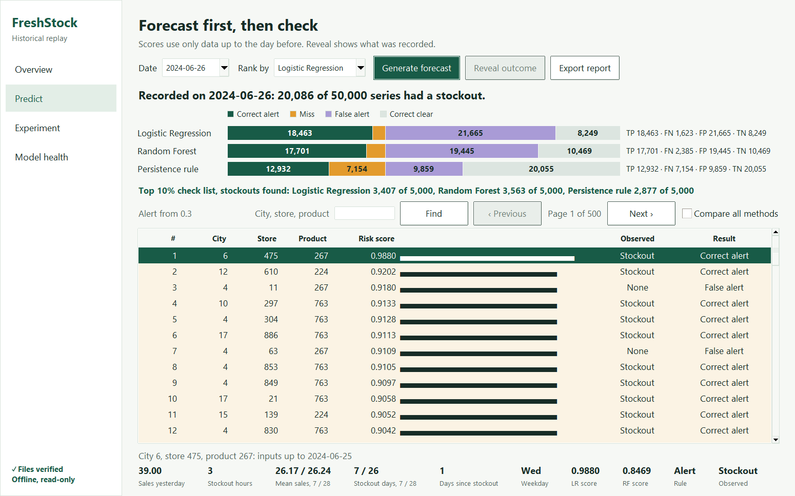
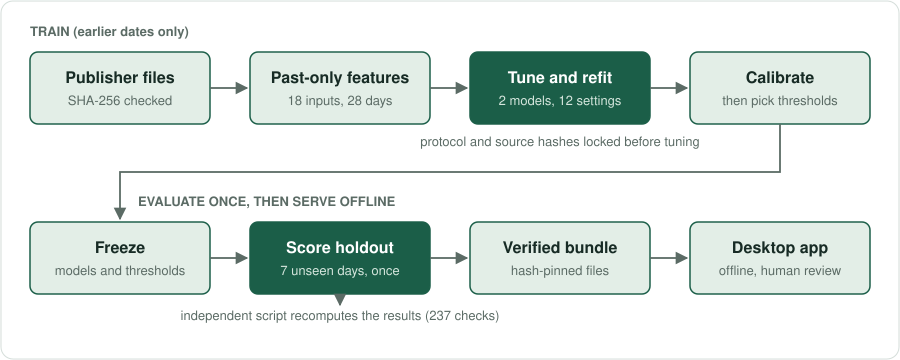
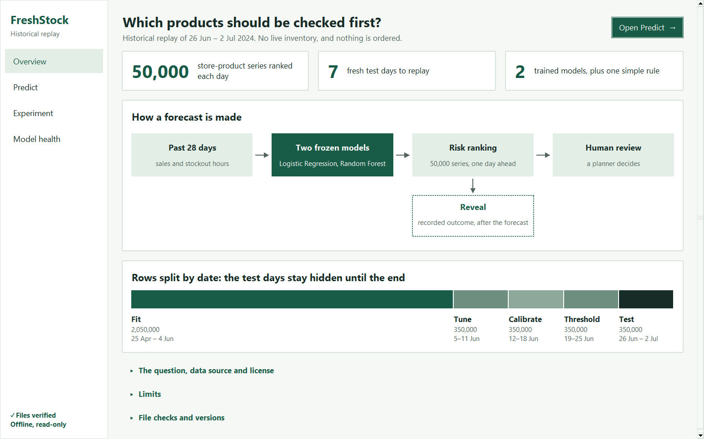
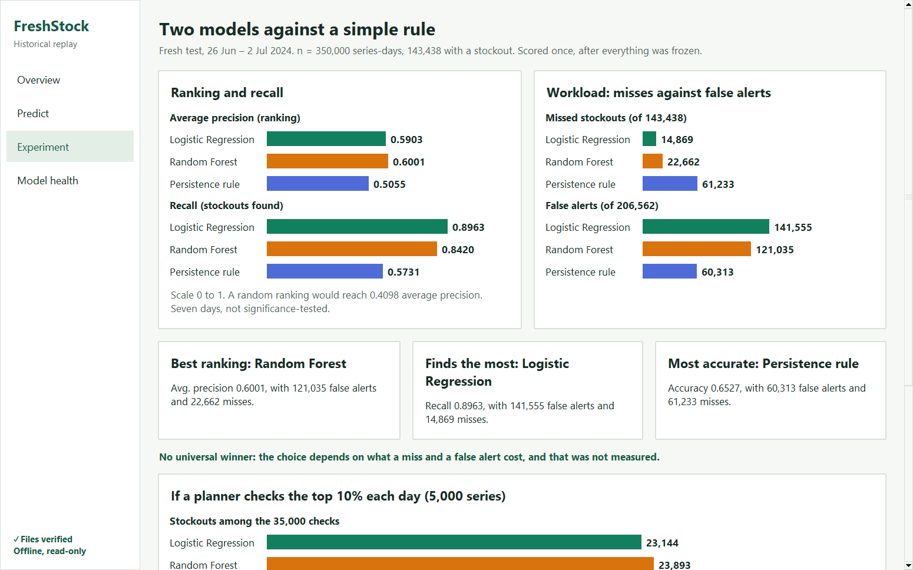

# FreshStock: next-day stockout risk for perishable retail

**Which products should a store planner check first tomorrow?** FreshStock ranks 50,000 store-product series by their risk of running out the next day, and compares two machine learning models with a simple rule on data neither model had seen.



| 4.85 million | 2 ML models | 350,000 | **+20%** | 306 |
|:---:|:---:|:---:|:---:|:---:|
| daily observations | Logistic Regression, Random Forest | fresh holdout rows, scored once | stockouts found at fixed capacity | automated tests |

## Result

A planner can only check so many products. With capacity fixed at the top 10% of the list (5,000 checks a day, 35,000 over the seven holdout days), the Random Forest found **23,893 stockouts against 19,905 for the rule: 3,988 more, or +20.0%**.

| Method | Stockouts found in 35,000 checks | vs. rule | Average precision | Accuracy |
|---|---:|---:|---:|---:|
| **Random Forest** | **23,893** | **+20.0%** | **0.6001** | 0.5894 |
| Logistic Regression | 23,144 | +16.3% | 0.5903 | 0.5531 |
| Rule: out of stock yesterday, so flag today | 19,905 | | 0.5055 | **0.6527** |

**What this does not show.** The models are better at *ranking*, not at every task. At their chosen alert threshold (0.3) they flag 69% to 77% of all series, and the simple rule keeps the best accuracy, precision and balanced accuracy. Always answering "no stockout" scores 0.5902 accuracy. No cost, saving or statistical significance was measured. Every number is in the [model card](docs/model_card.md).

## Method

**Question.** Will this store-product series record at least one out-of-stock hour between 06:00 and 22:00 tomorrow?

**Data.** [FreshRetailNet-50K](https://huggingface.co/datasets/Dingdong-Inc/FreshRetailNet-50K): 50,000 series over 97 days, from 18 cities, 898 stores and 865 products.

**Features.** Up to 18 inputs from past days only: recent sales, stockout hours and days over 1 to 28 days, days since the last stockout, and the weekday.

**Split by date, never at random.** Each step uses later days than the one before it:

| Fit | Tune (12 settings) | Calibrate | Pick threshold | Holdout |
|:---:|:---:|:---:|:---:|:---:|
| 25 Apr to 4 Jun | 5 to 11 Jun | 12 to 18 Jun | 19 to 25 Jun | **26 Jun to 2 Jul 2024** |



**Guardrails.** The protocol and source hashes are locked before tuning. The fit step cannot open the holdout file. Models and thresholds are frozen before scoring, and a second scoring attempt is refused. A separate script, sharing no project code, recomputed the results from the saved rows (237 checks, 0 failures).

## The application

A Windows desktop program that works offline. It replays the seven holdout days, ranks all 50,000 series in about one second per day, hides outcomes until you reveal them, and exports a report. It never places orders, and each model is opened only after its file hash is verified.

| Overview | Model comparison |
|:---:|:---:|
|  |  |

## Run it

**Windows program, no Python needed.** Download `FreshStock-2.0.0-portable.zip` from [Releases](https://github.com/newonathe/freshstock-stockout-prediction/releases), extract it and open `FreshStock.exe`. The program is not signed, so Windows may warn about an unknown publisher; compare the file with `SHA256SUMS.txt` first.

**From source.** Needs Windows and Python 3.12 or newer (tested on 3.14.2 and Windows 11).

1. Clone this repository.
2. Download `bundle_2.0.zip` from [Releases](https://github.com/newonathe/freshstock-stockout-prediction/releases) and extract it into the repository root, so that a `bundle` folder exists. Models are pickle files: open only the published, hash-checked ones.
3. Double-click `run_freshstock.bat`. It installs the locked packages once, then works offline.

## Reproduce

```powershell
python -m venv .venv
.venv\Scripts\python.exe -m pip install -r requirements.txt

# Automated tests
.venv\Scripts\python.exe -m unittest discover -s tests -t .

# Full experiment (about 8 GB of free memory; tuning and refit took 8.5 minutes on one laptop)
.venv\Scripts\python.exe -m freshstock.expanded audit --output audit.json
.venv\Scripts\python.exe -m freshstock.expanded lock --series 50000 --grid full --calibration sigmoid --forest-jobs 16 --blas-threads 6 --decision docs\results\E2_RESOURCE_DECISION.json --output lock.json
.venv\Scripts\python.exe -m freshstock.expanded fit --protocol lock.json --runs runs-expanded
.venv\Scripts\python.exe -m freshstock.expanded evaluate --run runs-expanded\RUN_ID --freeze-sha256 FREEZE_HASH
.venv\Scripts\python.exe -m freshstock.expanded verify --run runs-expanded\RUN_ID --freeze-sha256 FREEZE_HASH
```

Place the two publisher files at `data\raw\train.parquet` and `data\expanded\raw\eval.parquet` first; links and SHA-256 values are in [DATA_LICENSE.md](DATA_LICENSE.md). To check the published run without training, see [docs/results](docs/results/README.md).

**Tests.** All 306 pass when the data, models and pilot run are present. In a fresh clone 199 run and 107 are skipped, because large files are not stored in Git.

## Repository

```text
freshstock/               shared data contract, charts and view helpers, plus the 100-series pilot
freshstock/expanded/      FreshStock 2.0: features, training, evaluation, inference bundle, views
freshstock_desktop_2.py   2.0 application (freshstock_desktop.py is the pilot's)
tests/                    306 automated tests
tools/                    independent result check, Windows release builder
docs/                     model card, dataset card, frozen results, screenshots
```

The pilot stays because 2.0 builds on it and the regression tests cover both. Its results use other series and dates, so they are not comparable.

## Limits

- Seven consecutive days from the same publisher and series as training. No evidence for new stores, products, seasons or retailers.
- The evaluation file is public. It was fresh for this project, not secret.
- A recorded stockout is not lost demand, waste or money. Published sales are normalized by an undocumented factor.
- Scores rank risk; high scores were too high on the holdout, so they are not exact probabilities.
- Historical replay, tested on one Windows laptop. Not a live or monitored system.

## License and credits

Code: [MIT](LICENSE). Data and data-derived release files: FreshRetailNet-50K by Dingdong-Inc and [Wang et al. (2025)](https://arxiv.org/abs/2505.16319), CC BY 4.0; changes are listed in [DATA_LICENSE.md](DATA_LICENSE.md). Built with Python, scikit-learn, NumPy, pandas, SciPy, PyArrow and Tk.
